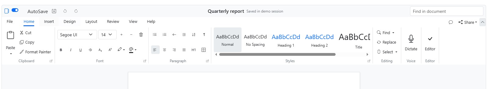
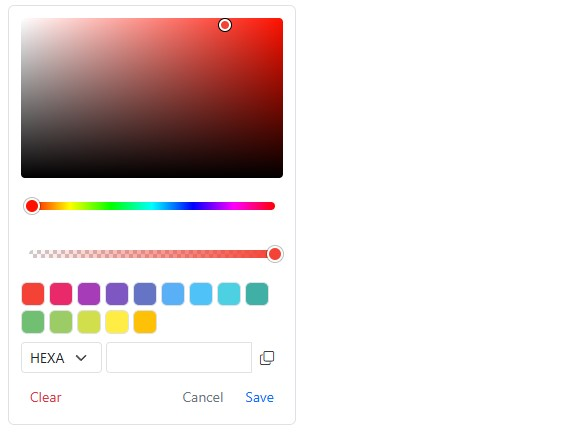
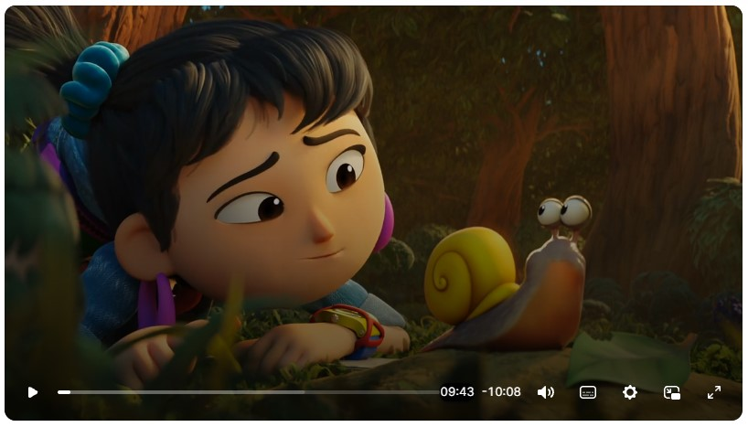
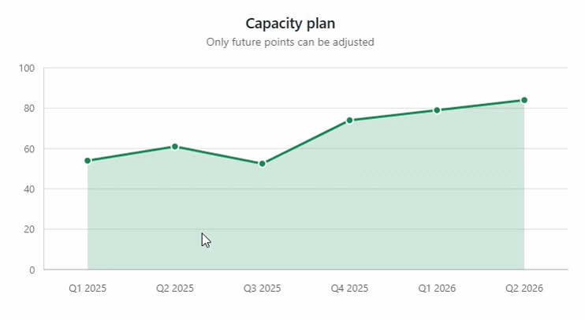
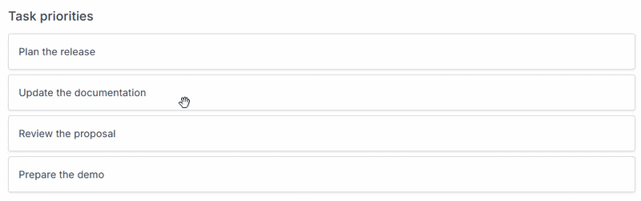
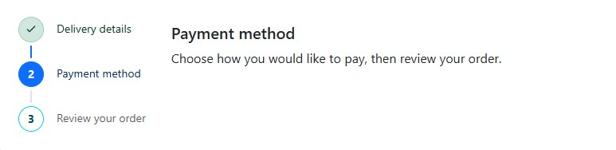
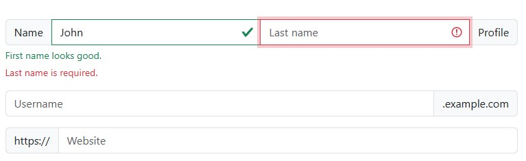
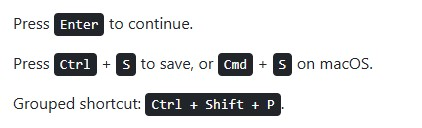

# Blazorise 2.4 - Release Notes

Blazorise 2.4, codenamed **Bura**, takes its name from the strong wind that blows along the Croatian Adriatic coast.

This release is a little different. Instead of building another large set of new components, we spent much of our time improving the parts of Blazorise people already use every day.

Some components have been rebuilt to remove old dependencies. Others received long-requested features, better keyboard support, cleaner styling, or fixes that had been on our list for a while. We also made changes that should make the framework easier to maintain and improve in future releases.

There are new additions too. **Ribbon** is the largest, giving applications a familiar way to organize editing commands, while smaller additions such as **Kbd** fill other gaps. Still, the main goal of 2.4 is to make Blazorise more reliable, easier to customize, and better prepared for what comes next.



> This song was playing quite a lot while I was working on Blazorise 2.4. It's been one of my personal favorites for years, so I thought I'd share it here as well.

## Key Blazorise 2.4 Highlights

Here are the changes that best represent this release:

- **Fewer external dependencies**: Tooltip and ColorPicker have been rebuilt using Blazor and Blazorise components.
- **Video update**: Video.js v10 replaces Plyr, improving support for streaming formats and external providers.
- **Better interactions**: SVG Chart data dragging, smoother drag-and-drop, and configurable animations.
- **Tabs and Steps**: Better accessibility and the long-requested vertical Steps layout.
- **Provider updates**: A FluentUI2 visual refresh and more predictable Tailwind utility overrides.
- **Fluent utility performance**: Cached utility values make repeated styling calls faster and avoid allocations for cached combinations.
- **More styling control**: Ghost buttons, a ZIndex utility, and vertical Slider support.
- **Ribbon (New)**: A command interface for editors and other tools, with flexible layouts, contextual tabs, and file menus.
- **Kbd (New)**: A consistent way to show keyboard keys and shortcuts.

## Upgrading from 2.3.x to 2.4

Update all **Blazorise.*** package references to **2.4**.

```cs
<PackageVersion Include="Blazorise" Version="2.3.*" />
<PackageVersion Include="Blazorise.Bootstrap5" Version="2.3.*" />
```

Change them to:

```cs
<PackageVersion Include="Blazorise" Version="2.4.0" />
<PackageVersion Include="Blazorise.Bootstrap5" Version="2.4.0" />
```

## Ribbon: A New Way to Organize Commands

The biggest new component in this release is **Ribbon**. We built it for applications where a simple toolbar isn't enough, such as document editors, spreadsheets, and design tools. As more commands are added, users need a way to find them without filling the screen with buttons.



The new `Blazorise.Ribbon` extension organizes commands into tabs and groups, with buttons, dropdowns, galleries, and color pickers. It offers **classic and simplified layouts**, so applications can choose between showing more tools at once or keeping the interface compact. Frequently used commands can stay available in a quick-access toolbar, and contextual tabs can appear when the user is working with something that needs its own tools.

File operations needed a place of their own too. Ribbon includes a compact file menu as well as **backstage pages** for actions such as opening, saving, and printing, without losing the current workspace. Keyboard navigation, localization, and options for rendering and animations are included, and a Word-style demo shows how the pieces work together. You can explore the component in the [Ribbon documentation](docs/extensions/ribbon).

## Revisiting Existing Components

One of our ongoing goals is to reduce the amount of external code we depend on where we can maintain a better Blazorise implementation ourselves. That was behind several changes in this release, although the right solution is not always to remove JavaScript entirely.

### Tooltip Improvements

**Tooltip** is now fully Blazor-native and no longer depends on **Tippy.js**. It is one example of where we can replace an external JavaScript library with our own Blazorise implementation.

A new `TooltipContent` fragment also makes tooltips much more flexible. Instead of being limited to simple text, tooltips can now contain rich content built with Blazorise components, typography, and utilities. The existing `Text` parameter remains available when only simple content is needed.

External triggers, themes, delays, interactive content, inline detection, and provider-specific styling continue to work as expected. The `AppendTo` parameter remains for compatibility, but is now obsolete and has no effect.

With the implementation under our control, we can improve Tooltip without waiting on an external library. The [Tooltip documentation](docs/components/tooltip) covers its configuration and examples.

### ColorPicker Improvements

The same work continued with **ColorPicker**, which has been rebuilt using Blazor and Blazorise components. Like our recent DatePicker and TimePicker rewrite, this removes another external JavaScript dependency and gives us more control over how the picker works across UI providers.



The new picker lets users choose colors from a **square selection area or color wheel**, fine-tune them with gradient sliders, select palette swatches, or enter HEXA and RGBA values directly. We also improved everyday use with a compact input layout, a copy button, and clear **Save, Cancel, and Clear** actions.

Optional menu animations and improved Ribbon integration help ColorPicker fit more naturally into different parts of an application. More examples are available in the [ColorPicker documentation](docs/components/color-picker).

### MemoInput Improvements

For **MemoInput**, we focused on autosizing. It now uses native browser capabilities where available, resulting in smoother resizing and more consistent behavior across UI providers.

Older browsers continue to work through a fallback, so existing applications don't lose autosizing support.

The optional JavaScript for tab handling is now loaded only when that feature is enabled, avoiding unnecessary work. The [MemoInput documentation](docs/components/memo-input) covers its input options.

### Video Improvements

For **Video**, the better long-term choice was to change the underlying player rather than build one ourselves. The component has been rebuilt on **Video.js v10**, replacing the previous Plyr-based implementation.



We made the change because video playback has grown beyond simple video files. Applications increasingly need streaming formats and external providers, and Video.js gives us a better base for supporting those scenarios while keeping the Blazorise API familiar.

The new implementation works with regular video and audio files, while adding better support for **HLS, DASH, YouTube, Vimeo, captions, quality selection, playback speed, and DRM-protected streams**. Integrations are loaded only when needed, and player assets are packaged locally to make deployment more predictable, especially for applications with stricter security policies.

Accessibility, localization, cleanup, and handling multiple players on the same page received attention as well.

This gives us a better base for supporting new streaming formats, providers, and browser capabilities. The [Video documentation](docs/extensions/video) includes setup and playback examples.

## Better Interactions and Everyday UI

A second area of focus was how components feel when people use them. We wanted to make editing, dragging, keyboard navigation, and layout changes clearer and more predictable.

### SVG Chart Data Dragging

One of the more visible changes is in **SVG Charts**. Charts can now act as visual editors, letting users change values directly where they see them.



Instead of adjusting values in a separate form and then checking the result, users can drag values and immediately see how those changes affect the chart. This works well for scenarios such as **forecasting, capacity planning, allocation, and scenario modeling**.

Data dragging works across several chart types, including stacked, point-based, and radial charts. Pointer and keyboard interaction, snapping, cancellation, and read-only controls give applications control over how values can be changed. The [SVG Chart documentation](docs/extensions/svg-chart) covers the chart types and options.

### Drag & Drop and Animation Improvements

Drag-and-drop interactions are easier to follow when users can see where an item will land. **DragDrop** now supports optional reorder animations that move surrounding items aside as you drag, with a moving placeholder to show the drop position.



Placeholders can display your own content or be hidden when needed. We also improved drop targeting around the first item in a zone, making reordering and moving items between zones more accurate.

Beyond drag-and-drop, applications now have more control over animations. **Accordion, Collapse, Alert, Carousel, and Dropdown** now expose `Animated` and `AnimationDuration`, so you can disable animations or adjust their speed for each component.

Dropdown positioning and submenu transitions were improved too, along with smoother Alert dismissal and movement of surrounding content. These changes make interactions feel more consistent across providers. You can find examples in the [Drag & Drop](docs/components/drag-drop) and [Animate](docs/extensions/animate) documentation.

### Tabs and Steps Improvements

One long-requested improvement is finally here: **vertical Steps**. It has been on our backlog for a long time and was requested many times by Blazorise users. Steps can now be placed beside their content, making them much better suited for longer forms, setup flows, and full-page wizards where a horizontal layout doesn't work well.



Along with vertical mode, Steps gained more control over how they are positioned and spread across the available space. We also refreshed their appearance across all supported providers, with clearer focus states, better spacing, improved selection colors, and cleaner connecting lines.

**Tabs** and **Steps** also received accessibility improvements for keyboard and screen reader users. Tabs now support arrow-key navigation, **Home** and **End** for jumping between the first and last tab, and **Enter** or **Space** for selection. Disabled and hidden tabs are skipped automatically, with improved focus handling and clearer links between tabs and their content.

Together, these changes make Tabs and Steps easier to use across more layouts, especially without a mouse. The [Steps](docs/components/step) and [Tabs](docs/components/tab) documentation show how to use them.

### Vertical Slider

**Slider** also gains **vertical orientation**, giving developers another way to fit value controls into their layouts without having to build a custom slider.

Horizontal sliders work well in forms, but they aren't always the best choice. In narrow side panels, toolbars, and controls arranged from top to bottom, a vertical slider can make better use of the available space. It's also a natural fit for interfaces such as volume controls, brightness settings, and other adjustments where users expect to move a value up or down.

You can choose whichever direction works best for your application. The [Slider documentation](docs/components/slider) includes examples of both layouts.

### Addons Validation Feedback

We also fixed a long-standing layout issue with **validation inside Addons**.



Validation messages could previously break the input group layout, push trailing addons onto another line, or cause rounded corners to render incorrectly. Feedback is now linked to each individual input while being displayed below the complete addon group, keeping the layout intact even when multiple inputs have validation messages.

The recommended structure now places `Validation` around each input inside its addon, with messages defined through the input's `Feedback` content.

Existing applications using the old structure can be updated automatically with **Blazorise.Migrator**. The [Addon documentation](docs/components/addon) covers input groups and their layout.

## Provider and Styling Improvements

We also spent time on the design systems themselves. These changes are less about adding components and more about making existing ones look and behave consistently, especially when applications customize their styles.

### FluentUI2 Visual Refresh

**FluentUI2** has received a visual refresh to more closely follow the upcoming **Fluent v3** design language.

We updated design tokens, sizing, spacing, and interaction states across the provider, with noticeable improvements to buttons, icon buttons, pagination, and navigation elements.

The **Bar** also received a larger rewrite. Horizontal and vertical navigation now use FluentUI2-specific styling instead of relying on shared behavior that was harder to adapt to Fluent's design. This improves responsive and collapsed navigation, nested menus, active and hover states, alignment, badges, and dark mode contrast.

The result is a provider that follows the direction of Fluent more closely while keeping the existing Blazorise APIs and Bar features intact.

### Tailwind Class Merger

For Tailwind users, we focused on a different problem. Overriding default component styles could sometimes be frustrating. Adding a new utility class didn't always produce the expected result because it could conflict with classes already applied by the component.

We've improved how the **Tailwind provider handles conflicting utility classes**. Important (`!`) utilities now take priority, while conflicting classes with the same priority follow the last one defined. This makes styling more predictable and reduces the need for custom CSS.

For example, setting `Padding="Padding.Is3.OnY"` on a Button now correctly replaces its default vertical padding while keeping the horizontal padding unchanged. Similarly, setting `Margin="Margin.Is4"` on a Row replaces its default negative horizontal margin.

This makes it easier to customize Blazorise components using Tailwind utilities without fighting their default styles.

### Ghost Buttons

We also added a **`Ghost`** appearance to buttons for actions that should remain subtle until users interact with them.

Ghost buttons are transparent and borderless by default, while still providing clear hover, focus, and active states. They work with `Color` across all supported UI providers and are useful for toolbars, inline actions, filters, and other places where regular buttons can add too much visual weight.

Ghost buttons are already used in **Gantt actions, DataGrid filters, and the PdfViewer toolbar**, with optional support in the Reporting and PropertyGrid toolbars. Their appearance options are covered in the [Button documentation](docs/components/button).

### ZIndex Utility

Another common styling problem is managing overlapping elements. Dropdowns, modals, tooltips, and custom overlays can easily lead to hardcoded `z-index` values that behave differently across CSS providers.

The new **`ZIndex`** utility gives you a consistent way to control these layers directly from Blazorise. Named values such as `ZIndex.Dropdown`, `ZIndex.Modal`, and `ZIndex.Tooltip` automatically use the correct stacking values for the active provider, so your components appear in the right order without provider-specific CSS.

For custom layouts, numbered levels, negative levels, or an exact integer value give you more control when needed.

## Faster Fluent Utilities

Fluent utilities are used throughout Blazorise to build spacing, sizing, and other styles. Many components request the same values over and over, so we looked at how much work was being repeated behind the scenes.

**Fluent utility calls now reuse cached values and their generated classes or styles**, instead of rebuilding them each time. In local .NET 10 benchmarks, repeated lookups of a representative set of DataGrid and layout expressions were about **90% faster**, with no allocations for cached combinations. These are measurements of the utility calls themselves, not full component rendering or page performance. The first use can cost a little more because the cache needs to be populated.

We also made chains returned by the static fluent APIs **immutable**, so reusing a cached value cannot accidentally change it elsewhere. When extending a chain, keep the returned value:

```csharp
var sizing = 8.Rem().Min(4).Max(12);
```

The caches have size limits to avoid unbounded memory growth, including a separate limit for numeric values that change frequently. Directly constructed builders keep their existing mutable behavior.

Most of this happens behind the scenes, but it reduces repeated work in components that use fluent utilities heavily and gives us a better base for future performance improvements.

## Smaller Improvements

A few smaller changes round out the release, with more consistent APIs and less code to write for common tasks.

### DisplayFormat Improvements

`DisplayFormat` now accepts standard **.NET format specifiers** directly, making formatting shorter and easier to read.

You can now use formats such as `C` or `dd.MM.yyyy` without wrapping them in a composite format. Existing formats such as `{0:C}` continue to work, so no changes are required in current applications.

The same formatting behavior is now available across **DataGrid, PivotGrid, and Gantt**.

### Alternative Text Naming

Image-related components now use a consistent `Text` parameter for alternative text.

Existing parameters such as `CardImage.Alt`, `FigureImage.AlternateText`, `Cropper.Alt`, and `QRCode.Alt` remain available for compatibility but are now obsolete. Existing applications will continue to work, while new code should use `Text`.

We also improved accessibility for **QRCode** and **Cropper**, ensuring the provided text is correctly passed to the rendered image and accessibility attributes.

### Kbd Component

The new `<Kbd>` component provides a simple way to display keyboard keys and shortcuts in instructions, help text, and tutorials.



It makes shortcuts such as `Ctrl` + `S` or `Esc` easier to recognize and keeps their appearance consistent with the active Blazorise provider.

## Final Notes

Blazorise 2.4 may not have the same number of major new components as some previous releases, but a lot of work went into it. Rebuilding Tooltip and ColorPicker, revisiting the Video player, improving accessibility, and fixing small problems in everyday components all take time. They're also the changes that make a difference when you're building and maintaining real applications.

One thing I've learned from working on Blazorise is that new features are only part of the job. Sometimes the best thing we can do is go back to something we built years ago, question an old dependency or design choice, and make it simpler. The Fluent utility caching work is a good example: users may never notice it directly, but the framework does less repeated work as a result.

Ribbon is a welcome new addition, and there's plenty more we want to build. For now, I'm glad we spent this release making the components we already have better and giving ourselves a cleaner base for the next one.

Thanks to everyone who reported bugs, asked for improvements, tested changes, or simply kept using Blazorise. A lot of this work started with your feedback.
